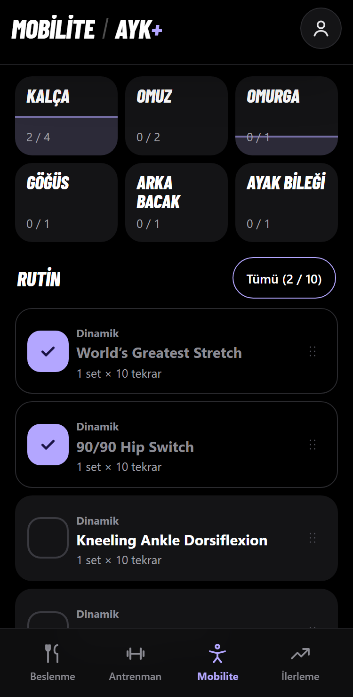
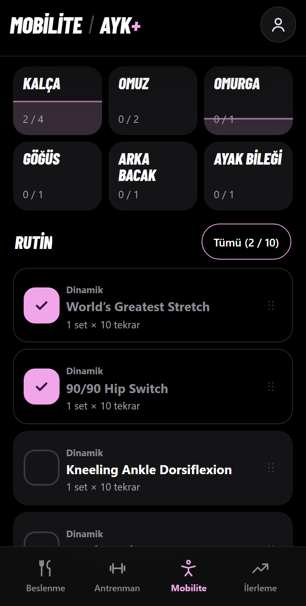
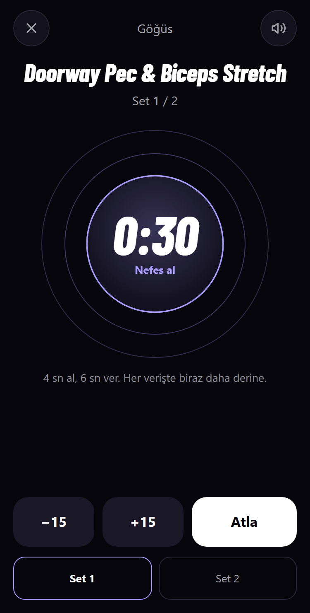
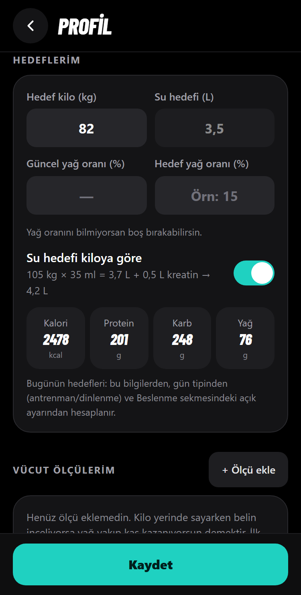
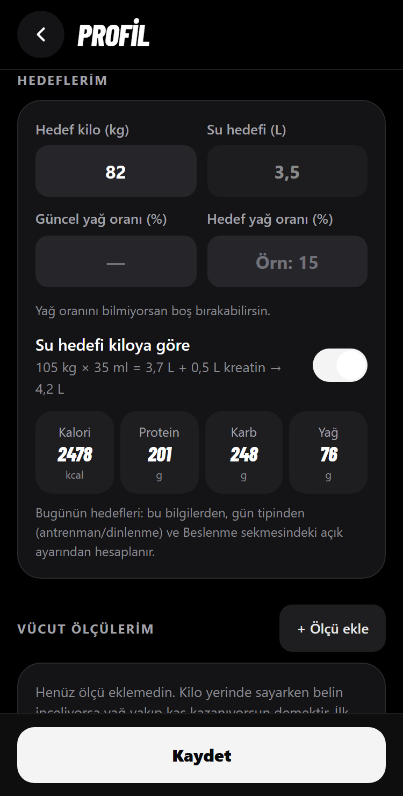
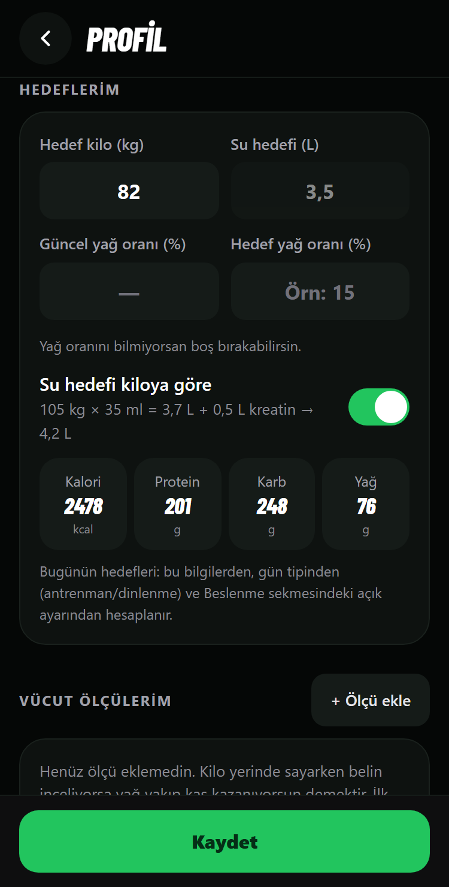

# AYK+ Tasarım Denetimi (v27, 14 Kasım 2026)

Bu belge ilk hâlinde yalnızca **inceleme ve öneri** içeriyordu.

> **Durum (v28, 14 Kasım 2026):** "Hemen" listesi uygulandı: A1.1, A1.2, A1.3, A1.4, A2.1, A2.2, A2.3 (b: `#15803D`), A2.4, A2.5, A3.1, A3.3, A5.1. Renk kararı: Mobilite **M3 Alacakaranlık**; vurgu `#A99CFF` yerine mevcut lavanta `#B3A6FF` kaldı, çünkü `#A99CFF` ailenin en sönük vurgusuydu. Profil **P2 Grafit**. Diğer maddeler açık. Doğrulama: `tests/test_v28_tasarim.py`; aynı ölçüm betiği v28'de bu ekranlarda kontrast uyarısı, taşma ve 44 px altı düğme bulmadı. Kalan tek uyarı vücut haritasındaki kas bölgeleri (A1.5).

**Yöntem**
- Uygulama gerçek Chromium'da (iPhone kipi, dokunmatik) **375 px** ve **320 px** genişlikte açıldı. 16 ekranın görüntüsü alındı (Beslenme ×5, Antrenman ×5, Mobilite ×4, İlerleme, Profil). Görüntüler: `docs/ANALIZ-tasarim/ekran/` (`375-…png`, `320-…png`).
- Her ekranda tarayıcı içinde otomatik ölçüm yapıldı: yazı/zemin kontrastı (WCAG 4,5:1, büyük yazıda 3:1), 44 px altındaki dokunma alanları, sayfanın yana taşması, 12 px altındaki yazılar, kesilen metinler, adı olmayan simge düğmeleri.
- Kurallar ui-ux-pro-max veritabanından alındı (`ux`, `chart`, `html-tailwind` alanları) ve `pro-rules.md` içindeki teslim öncesi kontrol listesiyle karşılaştırıldı. Veritabanında iPhone kenar boşlukları (safe area) için `html-tailwind` kaydı **bulunamadı**. Bu konu `pro-rules.md` içindeki "Safe-area compliance" kuralına ve kodun elle okunmasına göre değerlendirildi.

**Önem dereceleri**
- **Yüksek:** Kullanımı zorlaştırıyor veya yanlış dokunmaya yol açıyor.
- **Orta:** Fark ediliyor, okumayı veya dokunmayı zorlaştırıyor.
- **Düşük:** Cila; ileride toplu yapılabilir.

## Genel sonuç

| | Durum |
|---|---|
| Yana taşma (320 ve 375 px) | **Hiçbir ekranda yok** ✔ |
| Adı olmayan simge düğmesi | **Yok** ✔ (hepsinde `aria-label` var) |
| Konsol / sayfa hatası | **Yok** ✔ |
| Beslenme · Antrenman · Mobilite · Profil kontrastı | Koyu temada yalnızca 1 sorun ("Yedim"), gündüz temasında 1 sorun (alt menü) |
| İlerleme | Sorunların çoğu burada: 67 kontrast uyarısı, 12 küçük dokunma alanı, 8,5–10 px yazılar (hâlâ eski lacivert tema) |
| iPhone üst/alt kenar boşlukları | Doğru uygulanmış ✔ (başlık, alt menü, sayaç hapı, Profil, Mobilite sayacı, alt pencereler) |

Yeni temaya geçmiş üç bölüm (Beslenme, Antrenman, Mobilite) ve Profil büyük ölçüde kurallara uyuyor. Kalan sorunlar çoğunlukla **320 px'te sıkışma** ve **ince ayrıntılar**. İlerleme ise ayrı bir sürümde ele alınmayı hak ediyor.

---

## A) Görünümü değiştirmeyen iyileştirmeler

Bu maddeler renk paletine ve genel yapıya dokunmaz; sabit bölümlerde de yapılabilir. Bazı maddelerde gri yazının bir ton koyulaştırılması gibi küçük kontrast ayarları var; bunlar ayrıca belirtildi.

### A1 · Dokunma alanları (kural: en az 44 px)

| # | Önem | Ekran | Sorun | Öneri |
|---|---|---|---|---|
| A1.1 | **Yüksek** | İlerleme | Tartı ve ölçü satırlarındaki **"×" silme düğmesi 11×16 px**. Yanlış satırı silmek veya hiç dokunamamak çok kolay. | Düğmeyi 44×44 px yapın; görünen "×" aynı boyutta kalabilir. Silmenin zaten Geri al'ı var. |
| A1.2 | **Yüksek** | İlerleme | "7 / 14 / 30 gün" seçici, "📌 105 kg kaydet" ve "+ Ölçü Ekle" **27 px** yüksekliğinde; "Öneriyi uygula" 36 px. | En az 44 px yükseklik (`min-h-11`). |
| A1.3 | Orta | Antrenman → Bugün | "1. GÜN / 2. GÜN…" seçim düğmeleri **40 px**. | 44 px'e çıkarın (4 px fark, görünüm aynı kalır). |
| A1.4 | Orta | Antrenman → aktif antrenman | Her hareketteki "Not ekle" kutusu **33 px**. Sette elinizde dambıl varken dokunmak zor. | Kutu 44 px yüksekliğe çıkarılsın; yazı boyutu aynı kalabilir. |
| A1.5 | Düşük | Antrenman → Hareketler | Vücut haritasındaki küçük kas bölgeleri (ön kol, baldır) 17–30 px genişlikte. | Çizimin doğası gereği; dokunulamayan kaslar için altta zaten liste var. Liste haritanın hemen altındaysa sorun yok. |

### A2 · Kontrast (kural: normal yazı 4,5:1, büyük yazı ve simge/çerçeve 3:1)

| # | Önem | Ekran | Sorun (ölçülen) | Öneri |
|---|---|---|---|---|
| A2.1 | **Yüksek** | İlerleme | Gri yardımcı yazılar (`#64748B`, kartta `#1E293B` üstünde) **3,07:1**: "14 tartı • 13 gün", gün adları "Pt Sa…", "Bu hafta kaydedilmiş antrenman yok…". Takvimdeki boş gün numaraları **1,54:1** (neredeyse görünmez). | Gri yazıyı bir ton açın (`#94A3B8` → 5,71:1). Boş gün numaraları en az `#64748B` olsun. |
| A2.2 | **Yüksek** | İlerleme | Beyaz yazı yeşil düğmede (`#059669`) **3,77:1**: "Öneriyi uygula", seçili "14 gün". | Düğme zemini `#047857` (5,48:1). İlerleme'nin renkleri serbest olduğu için sorun yok. |
| A2.3 | Orta | Beslenme → Bugün | **"Yedim" düğmesi:** dolu yeşil `#16A34A` üstünde 14 px beyaz yazı **3,30:1**. Tasarımdaki dolu düğme rengi bu. | Beslenme renkleri sabit olduğu için **karar sizin**: (a) yazıyı 19 px kalın yapın (büyük yazı sayılır, 3:1 yeter) **veya** (b) yalnızca dolu düğmeler bir ton koyu `#15803D` olsun (5,02:1; gözle fark çok az). Öneri: (b). |
| A2.4 | Orta | Beslenme → Bugün (**gündüz teması**) | Alt menüdeki seçili olmayan sekme adları (`#8B8B93`, beyaz zeminde) **3,37:1**. | Gündüz temasında `#71717A` (4,82:1). Koyu tema etkilenmez. |
| A2.5 | Orta | Mobilite → liste | Boş onay kutusunun çerçevesi (`#3A3A40`, kart `#141416` üstünde) **1,63:1**. Kutunun içinde simge olmadığından "dokunulacak yer" zor seçiliyor. Sürükleme tutamacı (`#52525B`) **2,38:1**. | Çerçeve `#63636B` (3,09:1), tutamaç `#71717A` (3,81:1). |
| A2.6 | Düşük | Antrenman → aktif | Set onay düğmesinin çerçevesi aynı `#3A3A40` (1,63:1). | İçindeki ✓ simgesi yeterince görünür olduğu için düşük. İstenirse A2.5 ile aynı ton. |
| A2.7 | Düşük | Beslenme → Geçmiş | Hedef takviminde "Kayıt yok" açıklamasının renk noktası kart zemininden ayırt edilmiyor. | Noktaya ince çerçeve (`#2A2A2E` yerine `#52525B`). |

### A3 · 320 px (iPhone SE 1. nesil) yerleşimi ve hizalama

| # | Önem | Ekran | Sorun | Öneri |
|---|---|---|---|---|
| A3.1 | Orta | Beslenme, Antrenman (alt sekmeler) | 320 px'te 4. alt sekme kesiliyor: **"Geçmi" / "Geçm"**. Yana kaydırılabildiği belli değil. | Dört sekmeyi eşit genişlikte böl (`grid-cols-4`, metin ortalı), 360 px altında yazıyı 15 px yap. Kaydırma yerine sığdırma. |
| A3.2 | Orta | Beslenme → Bugün | 320 px'te öğün kartında besin adı **4 satıra** kırılıyor ("Tavuk / Göğsü / (Çiğ) / · 200 g"): solda zaman çizelgesi sütunu ve ortada geniş "⇄ İkame" düğmesi yer kaplıyor. | 360 px altında "İkame" yalnızca ⇄ simgesi olsun (44×44, `aria-label="İkame"`). Ad en fazla 2 satıra iner. |
| A3.3 | Orta | Profil → Hedeflerim | 320 px'te "Güncel yağ oranı (%)" 2 satıra kırılıyor, yanındaki "Hedef yağ oranı (%)" tek satır: **iki kutu farklı yükseklikte** (`320-profil-k3.png`). | Satırdaki kutuları alta hizala (`items-end`) veya etiketi kısalt: "Yağ oranı (%)" / "Hedef (%)". |
| A3.4 | Orta | Mobilite → liste | Bölge kutularında dolum çizgisi "0 / 1" yazısının **tam ortasından geçiyor** (Omurga); yazı üstü çizili gibi görünüyor. | Dolum seviyesini yazının altında bitir (en fazla kutu yüksekliğinin %40'ı) veya sayaç yazısına kartla aynı renkte küçük bir zemin ver. |
| A3.5 | Düşük | Mobilite → sayaç | 320×568 ekranda alttaki "Set 1 / Set 2" satırı ekrana sığmıyor, kaydırmak gerekiyor. | Nefes dairesi `min(300px, 78vw, 42vh)` olsun; kısa ekranda daire küçülür. |
| A3.6 | Düşük | Mobilite → detay | 320 px'te "Tekrar 10" sayacında rakam −/+ düğmelerine değiyor. | Sayının iki yanına 4 px boşluk veya 360 px altında 32 px rakam. |
| A3.7 | Düşük | Antrenman → Programım | 320 px'te hareket adları kısalıyor ("Chest-Supported R…"); sıra numarası sütunu geniş. | Numara sütunu 28 px'e insin veya ad 2 satıra izin versin. |
| A3.8 | Düşük | Antrenman → Geçmiş | "Grafikler ve rekorlar için İlerleme sekmesi →" yazısı 320 px'te düğme kenarlarına değiyor. | İç boşluk 16 px veya iki satıra izin. |

### A4 · Yazı boyutu (kural: 12 px altı kullanılmamalı)

| # | Önem | Ekran | Sorun | Öneri |
|---|---|---|---|---|
| A4.1 | Orta | İlerleme | Kilo grafiği ekseni **8,5–9 px**, kart altyazıları **10 px** (52 yerde). | Eksen 11 px, altyazılar 12 px. |
| A4.2 | Düşük | Tüm sekmeler | Alt menü etiketleri **11 px**. | 12 px. En uzun etiket "Antrenman"; 320 px'te 80 px'lik sütuna sığdığı uygulamadan sonra kontrol edilmeli. |
| A4.3 | Düşük | Mobilite → liste / ekle | "Dinamik", "Rutinde" etiketleri 11,5 px; sayaç düğmesindeki "30 sn" 11 px. | 12 px. |
| A4.4 | Düşük | Beslenme → Bugün / Geçmiş | "146 g kaldı", "/ 2.478 kcal", "kcal / gün" 11 px. | 12 px; koyu yeşil kartta okunur ama sınırda. |

### A5 · Kullanılabilirlik ve tutarlılık

| # | Önem | Ekran | Sorun | Öneri |
|---|---|---|---|---|
| A5.1 | Orta | Mobilite → Hareket ekle | Rutinde **zaten olan** harekette de aynı "+" düğmesi var; yalnızca 11,5 px "Rutinde" yazısı farkı söylüyor. İkinci kez eklemek mi, değil mi belirsiz. | Rutindekilerde düğme ✓ simgesi ve çerçeveli (dolu değil) olsun. Dokununca "Zaten rutinde. Yine de ekle?" diye sorsun. |
| A5.2 | Düşük | Profil → Hedeflerim | Kalori "**2478**" binlik ayırıcısız; Beslenme'de aynı sayı "**2.478**". | Profil'de de Türkçe binlik ayırıcı. |
| A5.3 | Düşük | Antrenman → Geçmiş | Boş durumda yalnızca "Henüz kaydedilmiş antrenman yok." yazıyor; ne yapılacağı söylenmiyor. Üstteki "0 antr. / 0 t" kartları boşken bilgi vermiyor. | Altına "Bugünün antrenmanını başlat" düğmesi; veri yokken üç kart gizlensin. |
| A5.4 | Düşük | Antrenman → aktif | İlk kullanımda "Tahmini 1RM ~0 kg · Tonaj 0 kg" yazıyor. | Değer 0 iken satırı gizle. |
| A5.5 | Düşük | Beslenme → Geçmiş (grafik) | Hedef tutturma takviminde anlam yalnızca renkle veriliyor (yeşil/sarı/kırmızı); renk körlüğünde ayırt edilmez. Kural: `chart` → Heatmap, "Do not rely on color alone". | Hücrelere küçük işaret: hedefte ✓, yakında "~", uzakta "!" (sayının altında 9 px değil, sağ üst köşede 12 px nokta/simge). |
| A5.6 | Düşük | İlerleme (grafik) | Kilo grafiğinde son noktanın etiketi ("102,9 kg") çizginin üstüne biniyor. Kural: `chart` → Line Chart; tablo yedeği zaten var (liste). | Etikete grafik zemini renginde arka plan veya noktanın üstüne kaydır. |

### A6 · Erişilebilirlik ve iPhone ayrıntıları

| # | Önem | Ekran | Sorun | Öneri |
|---|---|---|---|---|
| A6.1 | Orta | Tümü | `viewport` içinde `maximum-scale=1, user-scalable=no` var (yakınlaştırma engeli; `ux` → Viewport Meta). iOS Safari bunu çoğunlukla yok sayıyor; asıl işlevi, yazı kutusuna dokununca sayfanın kendiliğinden büyümesini önlemek. | **Şimdilik dokunmayın.** Kaldırılırsa önce 16 px altı tüm giriş kutuları 16 px yapılmalı (örn. Antrenman arama kutusu `t-search` 15 px). İkisi aynı sürümde yapılmalı. |
| A6.2 | Düşük | Tümü | Düğmelerde klavye odağı çerçevesi yok (yalnızca yazı kutularında var). iPad'e klavye takılırsa nerede olduğunuz görünmez. | Tüm düğmelere `focus-visible` çerçevesi: her bölüm kendi vurgu renginde 2 px. Dokunuşta görünmez. |
| A6.3 | Düşük | Tümü | "Hareketi azalt" ayarı yalnızca açılış ekranı, AYK+ yazısı ve nefes dairesi için uygulanıyor. Halka dolumu, bölge çizgisi, bildirim geçişleri kapsanmıyor. | Genel kural: hareket azaltılınca tüm geçişler ~0 sn. |
| A6.4 | Düşük | Tümü (iPad) | `theme-color` hâlâ eski lacivert `#0b1120`. iPhone'da durum çubuğu "black" olduğu için görünmüyor; iPad Safari'de sekme çubuğu lacivert görünebilir. | `#000000` (veya açık sekmeye göre). |
| A6.5 | Düşük | Tümü (iPad, yatay) | Sol/sağ kenar boşluğu (`safe-area-inset-left/right`) hiç kullanılmıyor. Dikey iPhone'da etkisi yok; iPad'de veya yatay tutuşta çentik yanı kenara yapışabilir. | Ana kapsayıcıya `padding-inline: max(16px, env(safe-area-inset-left))`. |
| A6.6 | Düşük | İlerleme | Başlığın altındaki "📊 Haftalık özet, kilo grafiği…" satırı yapışkan başlığın içinde; 320 px'te 2 satır ve ekranın ~%18'ini sürekli kaplıyor. | Açıklamayı başlıktan çıkarıp sayfanın en üstüne koyun (kaydırınca gitsin). |

**Kontrol edildi, sorun yok:** üst başlık ve alt menü iPhone çentiği / ana ekran çubuğu için doğru boşluk bırakıyor; Profil'in "Kaydet" çubuğu, Mobilite sayacı ve alttan açılan pencereler de öyle. Tüm simge düğmelerinin sesli okuyucu adı var. Beslenme, Antrenman, Mobilite ve Profil'de 44 px altı düğme yalnızca yukarıdaki maddelerde var. Tailwind sınıfları tam ve sabit metin olarak yazılmış (`html-tailwind` → "complete class tokens").

---

## B) Görünümü değiştiren öneriler: Mobilite ve Profil renkleri

**Aile kuralı (mevcut iki bölümden çıkarıldı):** saf siyaha yakın zemin; tek, açık tonlu vurgu rengi; dolu düğmede koyu yazı (Antrenman turkuaz `#1FD1C1` + `#00201D`, Beslenme zümrüt `#22C55E`). Beslenme ayrıca zeminleri kendi renginin çok koyu tonuyla hafifçe boyuyor (`#050706`, `#0E1210`).

**Kaçınılması gereken tonlar:** turkuaz/yeşil (Antrenman ve Beslenme ile karışır), mavi `#58B9F7` (protein), amber `#E5B85B` (karb), mercan `#E27C66` (yağ), pembe-kırmızı `#FB7185` (aşım/silme). Bu yüzden turuncu, sarı, mavi ve kırmızı seçenek **önerilmedi**.

ui-ux-pro-max palet veritabanı: "Mental Health" ve "Meditation & Mindfulness" ürünleri için **lavanta/mor** (`#8B5CF6`, `#7C3AED`), "Sleep Tracker (dark)" için **gece indigosu** öneriyor. Yani esneme ve sakinleşme için mevcut lavanta doğru aile. Aşağıdaki örnekler, gerçek uygulamanın tarayıcıda geçici olarak yeniden renklendirilmesiyle alındı (375 px).

### B1 · Mobilite

| Seçenek | Vurgu / üstündeki yazı | Zemin | Kontrast (vurgu yazı / zemin) | Örnek |
|---|---|---|---|---|
| **M1 Lavanta (mevcut)** | `#B3A6FF` / `#1B1446` | saf siyah, Antrenman ile aynı | 7,95 / 9,82 | `ANALIZ-tasarim/renk/M1-lavanta-liste.png`, `…-sayac.png` |
| **M2 Orkide** | `#F0A6E8` / `#3A0B36` | saf siyah | 8,84 / 11,32 | `M2-orkide-liste.png`, `M2-orkide-sayac.png` |
| **M3 Alacakaranlık** | `#A99CFF` / `#120F24` | indigo boyalı siyah: zemin `#07060D`, kart `#13111C`, yükseltilmiş `#1B1927`, çizgi `#2A2738` | 7,94 / 8,54 | `M3-alacakaranlik-liste.png`, `…-sayac.png` |

  

- **M1 Lavanta:** zaten uygulanmış, test edilmiş. Turkuaz ve yeşilden açıkça ayrılıyor. Zayıf yanı: zemin Antrenman ile birebir aynı; iki sekme arasında geçişte yalnızca vurgu değişiyor.
- **M2 Orkide:** üç bölüm arasında en belirgin ayrım; sıcak ve yumuşak, "esneme" hissine uygun. Zayıf yanı: aşım/silme rengi `#FB7185`'e M1'den daha yakın. Mobilite'deki "Kaldır" düğmesi kırmızı kaldığı için ikisi aynı ekranda görünebilir.
- **M3 Alacakaranlık (önerim):** vurgu lavanta kalıyor (bildiğiniz renk), zemin Beslenme'nin yaptığı gibi kendi renginin çok koyu tonuyla boyanıyor. Böylece üç bölüm **aynı kuralla** çalışır: Antrenman saf siyah, Beslenme yeşil-siyah, Mobilite indigo-siyah. Sayaç ekranında nefes dairesiyle birlikte en sakin görünen seçenek.

### B2 · Profil

Profil şu an Antrenman'ın turkuazını kullanıyor; oysa içinde Beslenme hedefleri (kalori, makro, su) de var.

| Seçenek | Vurgu / üstündeki yazı | Fikir | Örnek |
|---|---|---|---|
| **P1 Turkuaz (mevcut)** | `#1FD1C1` / `#00201D` | Değişiklik yok. | `P1-turkuaz-ust.png`, `…-hedef.png` |
| **P2 Grafit** | `#F4F4F5` / `#09090B` (18,1:1) | Profil hiçbir bölüme ait olmayan ortak alan: renksiz, beyaz düğmeler. "Kaydet" beyaz. | `P2-grafit-ust.png`, `…-hedef.png` |
| **P3 Bağlama göre** | açıldığı sekmenin rengi | Profil, açıldığı sekmenin rengini ve zeminini alır: Beslenme'den açılınca yeşil, Mobilite'den lavanta, Antrenman'dan turkuaz. Ortak pencereler (`.tm` / `.nm`) zaten böyle çalışıyor. | `P3-baglam-beslenme-hedef.png`, `P3-baglam-mobilite-ust.png` |

  

- **P1:** en az iş. Ama Profil'i "Antrenman'ın bir parçası" gibi gösteriyor.
- **P2 (önerim):** sade ve her sekmeyle uyumlu; ayarlar ekranında vurgu rengine az ihtiyaç var. İsterseniz Hedeflerim'deki dört kutuya makro renkleri eklenebilir (Protein mavi, Karb amber, Yağ mercan). Böylece Beslenme ile bağ kurulur.
- **P3:** en "akıllı" görünen seçenek ve kopukluk hissi yok. Zayıf yanı: aynı ekran her seferinde farklı renkte açılıyor. Ekran görüntüsüyle geri bildirim verirken karışıklık yaratabilir.

### B3 · Not: İlerleme

Renkleri serbest bölümlerden İlerleme hâlâ eski lacivert temada. A bölümündeki sorunların yarısı burada: kontrast, 27 px düğmeler, 8,5–10 px yazılar, başlıklarda emoji simgeler (🧠 📅 💪; diğer sekmelerde çizgi simge kullanılıyor). Bu belgede istenmediği için renk seçeneği çizilmedi. Mobilite ve Profil kararından sonra aynı aile kuralıyla (siyah zemin + tek vurgu) yeniden tasarlanması önerilir.

---

## Önerilen sıra

1. **Hemen (tek küçük sürüm, görünüm değişmez):** A1.1, A1.2, A2.1, A2.2 (İlerleme dokunma/kontrast), A1.3, A1.4, A2.3 (karar gerekir), A2.4, A2.5, A3.1, A3.3, A5.1.
2. **Sonra:** A3.2, A3.4, A4.x, A5.2–A5.6, A6.2–A6.6.
3. **Renk kararı:** Mobilite (M1 / M2 / M3) ve Profil (P1 / P2 / P3). Karar verildikten sonra uygulanır.
4. **Ayrı sürüm:** İlerleme'nin yeni temaya geçişi.
